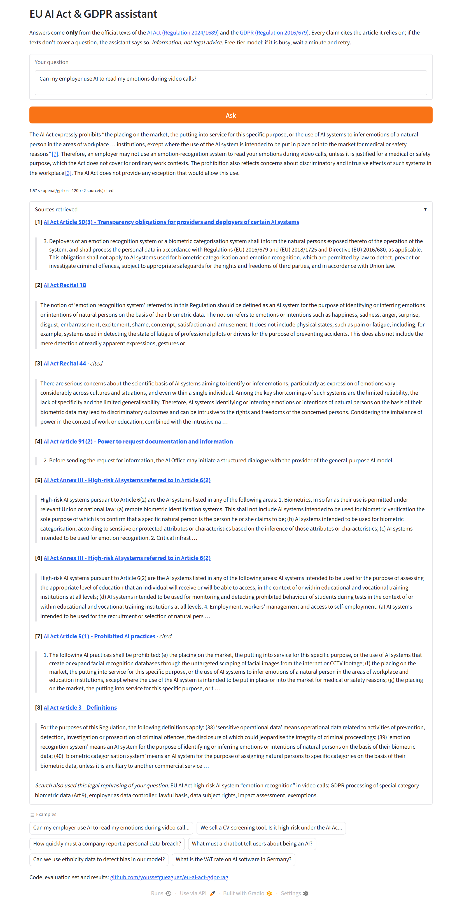
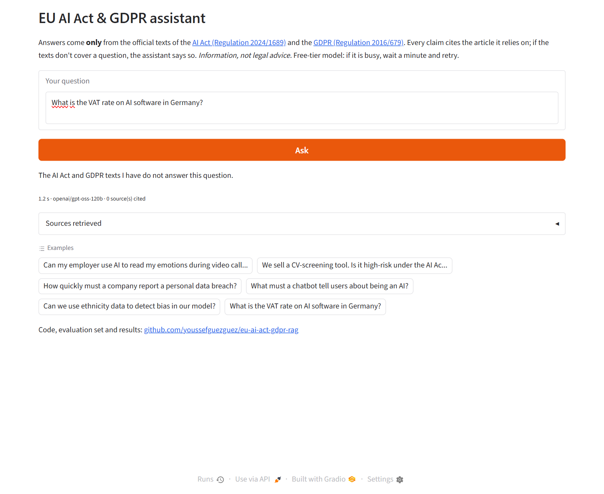

# EU AI Act & GDPR assistant: RAG with an evaluation harness

A question-answering assistant over the full text of the **EU AI Act** (Regulation 2024/1689)
and the **GDPR** (Regulation 2016/679). Every claim in an answer cites the article it comes
from. If the two laws don't cover a question, it declines instead of guessing.

The point of the project is less the chatbot than the **measurement**: a 76-question test set
with gold articles, a fixed dev/test split, and an ablation of every retrieval choice, so each
design decision is backed by a number.

**Live demo:** {{DEMO_URL}} (free hosting: the first question after a quiet period takes about a minute while
the server wakes up). JSON API docs at `/docs`. Information, not legal advice. [](https://github.com/youssefguezguez/eu-ai-act-gdpr-rag/actions/workflows/ci.yml)

| A cited answer (sources expanded) | Declining an out-of-scope question |
|---|---|
|  |  |

## Results (held-out test split)

Pipeline frozen before the test split was run. Test: 34 answerable + 3 unanswerable questions. Dev: 36 + 3.

| Metric | Test | Dev |
|---|---|---|
| Out-of-scope questions correctly declined | **100%** (3/3) | 100% (3/3) |
| Answerable questions wrongly declined | **0%** | 0% |
| Correct article among the 8 sources retrieved | 82.4% | 97.2% |
| Answer cites a correct article | 82.4% | 97.2% |
| Faithful: every claim supported by its cited source (LLM judge) | 82.4% | 91.7% |
| Correct vs reference answer (LLM judge) | **79.4%** | 88.9% |
| Correct or partly correct (LLM judge) | 91.2% | 97.2% |
| Citation numbers pointing to non-existent sources | 0% | 0% |

Dev is higher than test because every design choice was tuned on dev, which is why test is
the number to quote. Excluding the two test items seen during debugging (q065, q069),
test correctness is 81.2% (n = 32). Answers take about 4–5 s when the free tier isn't
rate-limiting.

**Retrieval on test** confirms the main retrieval decision, but only partly the rewriting:

| Retrieval (test, 34 questions) | R@5 | R@8 | MRR@10 |
|---|---|---|---|
| BM25 | 44.1% | 50.0% | 0.285 |
| Hybrid BM25 + dense (RRF) | 52.9% | 61.8% | 0.405 |
| Dense bge-small | 58.8% | 73.5% | 0.487 |
| + recital penalty | **76.5%** | 79.4% | 0.594 |
| + LLM rewrite, top 4 kept (final, 8 sources) | 73.5% | **82.4%** | 0.599 |

The recital penalty holds up (+17.7 points R@5). Rewriting gained 8 points R@8 on dev but
only 3 on test (one question), so its benefit is small and uncertain at this sample size.

**Where it fails (test).** In 5 of the 6 answers the judge flagged, the correct article was
not among the retrieved sources. The model then answered from the wrong sources instead of
declining. In the worst case it reasoned from absence: asked about an AI that rejects job
applicants, it said recruitment "is not listed in Annex III". It is listed there; the
passage simply wasn't retrieved. The next step is a prompt rule that never treats "not in the
sources" as "not in the law", plus a partial-decline path. It would be evaluated on new
questions, since the test split has now been used.

## How it works

```
question ──► LLM rewrite into legal vocabulary (gpt-oss-120b)
         │
         ├─► dense search (bge-small, recital penalty) on the original question ──► top 4 kept
         └─► RRF fusion of original + rewrite rankings ──────────────────────────► fills to 8
                                                                                      │
             gpt-oss-120b answers from the 8 numbered sources, cites [n], or declines ◄┘
```

1. **Ingestion** (`src/ingest.py`). Official EUR-Lex HTML is parsed by structure: article →
   paragraph, recitals and annexes split on sentence/point boundaries (≤1,500 characters),
   with list lead-ins repeated so a chunk like "(f) … emotions in the workplace" keeps its
   "The following AI practices shall be prohibited:" context. Result: 1,461 chunks, each with
   a citation heading (e.g. *AI Act Article 5(1) – Prohibited AI practices*) and a deep link.
2. **Retrieval** (`src/retrieve.py`). `BAAI/bge-small-en-v1.5` embeddings. Recitals (the
   explanatory preamble) get a small score penalty, because they paraphrase the articles
   and were crowding the binding text out of the top results.
3. **Query rewriting** (`src/generate.py`). Users say "legal grounds", the GDPR says
   "lawfulness of processing". The LLM rewrites the question in regulatory vocabulary, and the
   two rankings are fused. The plain question's top 4 are always kept, so a bad rewrite can
   only add candidates, not remove good ones.
4. **Generation**. `openai/gpt-oss-120b` (open weights, Apache 2.0) via Groq's free tier,
   temperature 0, sources numbered `[1]…[8]`. Citations are parsed and mapped back to chunk
   ids, so citation accuracy is measured exactly. Declining uses one fixed sentence, so it is
   detected exactly too.

## Evaluation

**Test set** (`eval/questions.jsonl`): 76 hand-written questions, each with the set of chunks
that answer it, found and checked in the legal text.

| Type | n | Example |
|---|---|---|
| plain | 41 | "Can a government rank its citizens based on how they behave socially?" |
| scenario | 16 | "We sell a CV-screening tool that ranks job applicants. Is it high-risk under the AI Act?" |
| exact | 8 | "What is the maximum fine for using a prohibited AI practice?" |
| cross-regulation | 5 | "Does the AI Act replace the GDPR for AI systems that use personal data?" |
| unanswerable | 6 | "What is the VAT rate on AI software sold in Germany?" |

The split is fixed and stratified by type (alternating items): **dev** for every design
decision, **test** run once at the end.

**Judge.** Correctness and faithfulness are graded by `qwen/qwen3.8-27b`, a different model
family from the generator, to limit self-preference. The judge was audited on 10 dev answers
(5 it flagged, 5 it passed): it agreed with a second grader on 10/10 correctness and 8/8
faithfulness verdicts ([grades](eval/results/spot_check_dev_grades.md)). The second grader
was also an LLM (Claude), not a human, which is weaker evidence.

## What was tried (dev split, 36 answerable questions)

Every run is logged in [`eval/results/experiments.jsonl`](eval/results/experiments.jsonl).

| Retrieval setup | R@5 | R@10 | MRR@10 | Time per query | Kept? |
|---|---|---|---|---|---|
| BM25 (keywords) | 41.7% | 50.0% | 0.244 | <0.1 s | no |
| Hybrid BM25 + dense (RRF) | 50.0% | 69.4% | 0.358 | <0.1 s | no: BM25 drags dense down |
| Dense bge-small (baseline) | 72.2% | 77.8% | 0.389 | <0.1 s | |
| + recital penalty 0.05 | **83.3%** | 86.1% | **0.595** | <0.1 s | **yes** |
| Weighted BM25 + dense (α = 0.8) | 61.1% | 88.9% | 0.409 | <0.1 s | no |
| Dense bge-base + penalty 0.05 | 83.3% | 88.9% | 0.603 | <0.1 s | no: no gain, heavier |
| Dense bge-base + penalty + cross-encoder reranker (bge-reranker-base) | 83.3% | 88.9% | 0.615 | 5.8 s (CPU) | no: no gain, 50× slower |
| + LLM rewrite, fused (R@8 = 91.7%) | 80.6% | 94.4% | 0.649 | +1 LLM call | yes |
| + keep the plain question's top 4 (R@8 = **97.2%**) | | | | | **yes** |

Takeaways:
- **The cheapest fix won.** A one-line score penalty on recitals beat a bigger embedding model
  and a reranker.
- **Hybrid search is not automatically better.** On paraphrased legal questions BM25 was weak
  (42% R@5), and fusing it in made dense retrieval worse.
- **Rewriting helps recall but can hurt.** On its own it lost results the plain question had
  found. On *"Can my company detect employees' stress during video calls?"* it pushed out the
  ban in Art. 5(1)(f), and the answer wrongly said the use was permitted. Always keeping the
  plain question's top results fixed this (dev correctness 80.6% → 88.9%).

## Known limitations

- 76 questions is small: one question is 2.8 points on dev. Differences of 1–2 questions
  are noise.
- I wrote the questions and gold sets myself while reading the texts. That's careful but not
  independent, and the gold sets may miss other valid passages.
- Two test items (q065, q069) were seen while debugging, before the test run. Results are also
  reported without them.
- The judge is an LLM. Its audit was done by another LLM, not by a lawyer.
- Only the two regulations are indexed: no delegated acts, guidelines, case law or national law.
- Free-tier limits: 8k tokens/min and 200k tokens/day per model. When the main model's daily
  quota is used up, the demo falls back to `gpt-oss-20b`, and the answer footer says so.

## Deployment

The live demo is a **FastAPI** service (`api.py`) in a **Docker** image on Render's free plan
(512 MB RAM), built and redeployed on every push to `main`.

- **No PyTorch at serving time.** The index was built with sentence-transformers; queries are
  embedded with BAAI's official ONNX export of the same model on onnxruntime
  (`src/onnx_embed.py`). `tests/test_onnx_parity.py` checks the two encoders on all 76
  evaluation questions: cosine > 0.9999 and **identical top-8 rankings**, so the reported
  results still hold. Memory: ~250 MB resident instead of over 1 GB with torch.
- **Endpoints:** `GET /` web page, `POST /ask` cited answer as JSON, `GET /health`.
- **Abuse limits** (it spends a free API key): questions ≤ 500 characters, per-IP rate limit
  (4/min, 40/day), at most 2 answers generated at once.
- **Logs** keep latency, tokens, model and decline/citation counts per answer, never the
  question text. A local run: ~2 s and ~2.3k tokens per answer (rewrite + answer calls).
- **CI** (GitHub Actions): unit + API tests with the LLM stubbed, then a Docker build and a
  `/health` smoke test of the container.

## Run it

```bash
python -m venv .venv && .venv/Scripts/activate      # Windows; use bin/activate elsewhere
pip install -r requirements.txt
echo GROQ_API_KEY=your_key > .env                    # free key: console.groq.com

python src/ingest.py                                 # EUR-Lex HTML -> data/processed/chunks.jsonl
python src/retrieve.py --build                       # embedding index (included in the repo)
python src/generate.py "Is emotion recognition at work allowed?"
python app.py                                        # Gradio demo
EMBED_BACKEND=onnx uvicorn api:app --port 8000        # the deployed API (after scripts/fetch_onnx.py)
pytest -q                                            # tests (ONNX parity runs when torch is installed)

python eval/eval_retrieval.py --split dev            # retrieval metrics, no API calls
python eval/experiments.py                           # the ablation table above
python eval/eval_generation.py --split dev           # end-to-end answers + judge (resumable)
```

## Repository

```
src/ingest.py        EUR-Lex HTML -> structure-aware chunks
src/retrieve.py      BM25 / dense / hybrid / rerank, recital penalty, multi-query fusion
src/generate.py      query rewriting, cited generation, decline detection, rate-limit handling
api.py               FastAPI service (deployed): web page, /ask, /health, rate limits
web/index.html       the deployed web page
src/onnx_embed.py    torch-free query encoder (ONNX) for the API
app.py               Gradio demo (local)
tests/               unit, API and ONNX-parity tests
Dockerfile, render.yaml, .github/workflows/ci.yml   container, Render blueprint, CI
eval/questions.jsonl 76 questions with gold chunk ids
eval/*.py            retrieval eval, ablations, rewrite eval, end-to-end eval with LLM judge
eval/results/        all logged runs, generated answers, judge audit
scripts/             inspection and debugging helpers
```

Source texts © European Union, [EUR-Lex](https://eur-lex.europa.eu/), reused under the
Commission's reuse policy (Decision 2011/833/EU).
